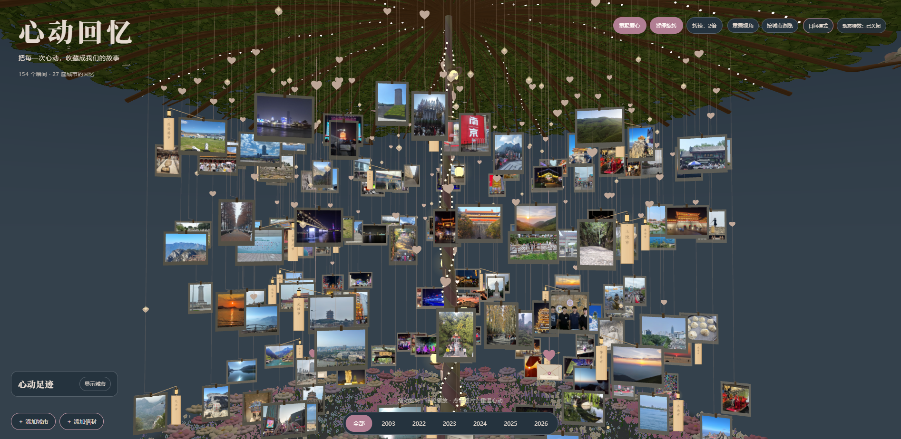
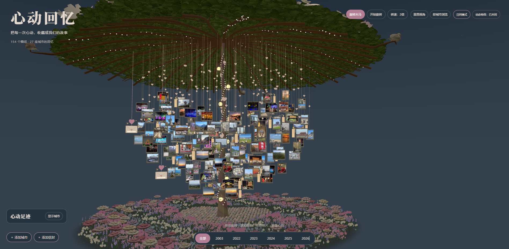
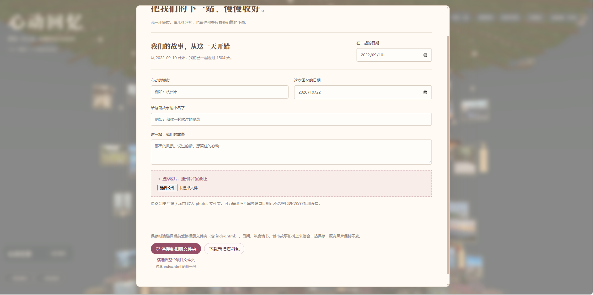
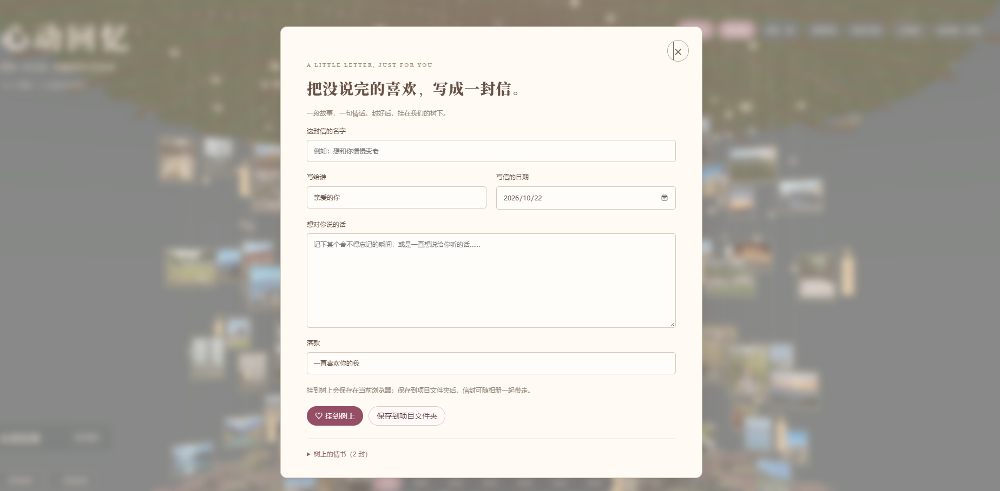
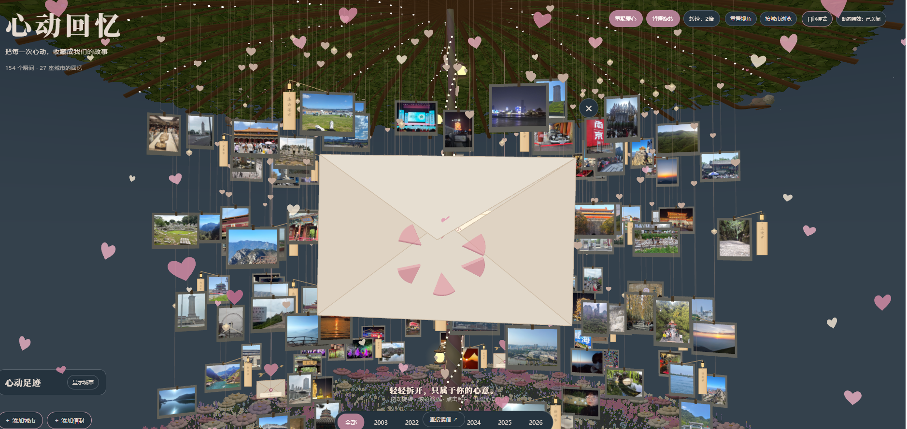
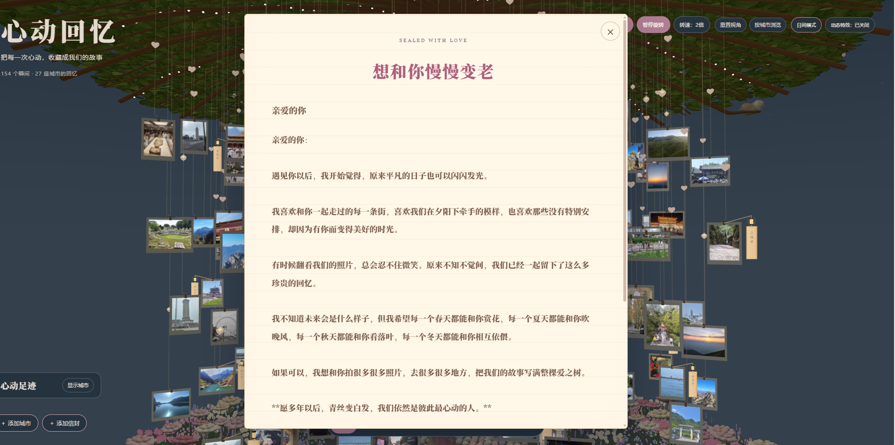
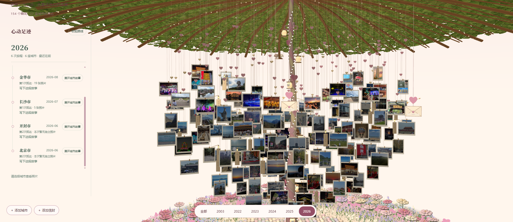
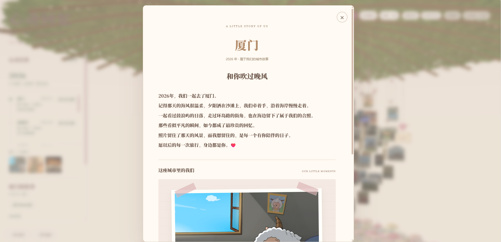

# 旅行年轮树 · 心动回忆

可离线使用的 Three.js 三维相册。照片悬挂在树冠下，支持旋转木马、立体爱心、城市浏览，以及可编辑的信封和年度情书。

[在线体验](https://zwxll.github.io/travel-memory-tree/)

在线版使用 72 张程序生成的示例卡片，可体验照片布局、城市高亮与信封编辑。没有预置真实照片、旅行记录或私人信件，编辑内容保存在访问者自己的浏览器中。

公开仓库提供代码、空白数据模板、使用说明和下方明确选用的八张界面截图。原始照片库、旅行资料、纪念日期与信件的数据文件、浏览器导出资料均保留在本地。

## 界面预览

以下为本地版本截图，点击图片可查看大图；在线演示使用程序生成的示例卡片。

| 旋转木马与夜景 | 立体爱心布局 |
| :---: | :---: |
| [](docs/previews/carousel-night.png) | [](docs/previews/heart-layout.png) |
| 照片随树旋转，支持城市高亮、日夜切换与动态特效控制。 | 在木马与立体爱心之间切换，也可独立控制旋转。 |

| 添加城市与相册设置 | 写信与信封管理 |
| :---: | :---: |
| [](docs/previews/city-editor.png) | [](docs/previews/envelope-editor.png) |
| 记录城市与故事，添加照片，并保存到本地相册文件夹。 | 写下心意并挂到树上；已有信件可重新打开编辑。 |

| 拆信动画 | 信纸阅读 |
| :---: | :---: |
| [](docs/previews/envelope-animation.png) | [](docs/previews/letter-reader.png) |
| 点击信封播放拆封、抽出与展开信纸的动画，也可直接读信。 | 长信支持滚动阅读，关闭按钮保持固定。 |

| 年份旅行路线 | 城市故事相册 |
| :---: | :---: |
| [](docs/previews/year-route.png) | [](docs/previews/city-story.png) |
| 按年份浏览旅行足迹，查看城市、出行日期与照片数量。 | 展开城市故事，阅读文字并回看这座城市里的照片。 |

## 使用

首次下载仓库后，在项目目录执行：

```sh
npm run setup
```

也可以手动将 `data/photos.example.js` 和 `data/user-records.example.js` 分别复制为 `photos.js` 和 `user-records.js`。已有本地资料不会被初始化命令覆盖。

双击 `index.html`，使用 Edge 或 Chrome 打开。展示无需服务器、登录或联网。通过左下角“添加城市”导入自己的照片，再保存到本项目文件夹。首次使用没有预置照片或私人故事。

- 拖动旋转，滚轮缩放；右上角可切换木马、爱心、旋转速度及日夜氛围。
- 白天是杏粉天空、缓慢薄云与树后暖光；夜晚是蓝灰天空、弯月与稀疏星光。关闭动态特效或启用减少动态效果时，云层保持静止。
- 点击城市高亮对应照片；点击场景空白、树干或地面清除城市筛选，保持当前视角和缩放。
- 点击照片查看完整图片，支持上一张、下一张、缩略图、方向键和 Esc。
- 点击年份查看年度情书与城市路线；可修改城市故事。
- 点击“添加信封”写信。打开已有信件后，点击正文下方的“编辑这封信”修改保存；关闭编辑窗口则保留原内容。
- 尊重系统减少动态效果设置；没有 WebGL 时仍可通过城市列表浏览。

## 本地资料与备份

编辑先保存在当前浏览器。需要备份或换设备时，使用“保存到项目文件夹”或下载资料包，再复制完整的本地项目目录。浏览器缓存不会自动随文件夹一起移动。

照片原文件位于 `photos/`，离线图像与旅行资料位于 `data/photos.js`、`data/user-records.js`；`data/catalog.json` 是可选的本地清单。这些文件均被 Git 忽略。详细约定见 [data/README.md](data/README.md)。

## 开发

需要 Node.js 18 或更高版本：

```sh
npm ci
npm run build
npm test
```

构建直接更新 `assets/tree-runtime.js`，无需再手动复制重复产物。浏览器运行时不需要 Node.js。

`npm test` 使用合成测试资料，检查相册文件、信封和故事存储、两种照片布局及年份路线，不读取私人照片。

提交或上传前执行 `npm run check:public`，检查 Git 暂存清单中没有私人数据文件、未经指定的图片、压缩备份或凭据；界面预览仅放行上方八张截图。

浏览器回归需要自行安装 Playwright 和 Edge；可向测试脚本传入已有 Playwright 模块路径。例如：

```sh
node tools/city-focus-browser-test.cjs "Playwright 模块路径"
node tools/envelope-browser-test.cjs "Playwright 模块路径"
node tools/mode-browser-test.cjs "Playwright 模块路径"
node tools/album-browser-test.cjs "Playwright 模块路径"
node tools/public-checkout-test.cjs "Playwright 模块路径"
node tools/site-browser-test.cjs "Playwright 模块路径"
node tools/route-layout-browser-test.cjs "Playwright 模块路径"
node tools/sky-background-browser-test.cjs "Playwright 模块路径"
```

场景类浏览器测试需要本地已有照片；`album-browser-test.cjs` 使用临时合成资料；`public-checkout-test.cjs` 只从 Git 文件创建临时副本，验证空白初始化、可重复构建与照片导入入口。测试生成的图片、报告和临时文件不会提交。

`sky-background-browser-test.cjs` 使用公开示例，检查云层启停、日夜背景、电脑与手机上的弯月，以及照片原色和布局保持不变。

## 在线部署

推送到 `main` 后，GitHub Actions 会构建并发布 GitHub Pages。首次配置时，在仓库 Settings → Pages 中选择 GitHub Actions 作为发布源。

`npm run build:site` 只将入口、两个运行脚本、程序化示例与空白资料模板写入 `.pages/`。本地 `photos/`、`data/photos.js`、`data/user-records.js` 和旅行清单不参与在线构建。工作流只发布这份独立目录，不上传整个本地项目。

`node tools/site-browser-test.cjs "Playwright 模块路径"` 可检查仓库子路径访问、示例画面、布局与信封编辑，以及是否出现外部服务请求。

## 目录

| 目录或文件 | 用途 |
| --- | --- |
| `index.html` | 离线入口 |
| `assets/` | 启动脚本与打包后的相册 |
| `data/*.example.js` | 可公开的空白资料模板 |
| `src/assets/travel-ring-tree/` | 相册源码、样式、模板及构建脚本 |
| `src/assets/umbrella-canopy/` | 基础场景、花园与本地第三方依赖 |
| `tools/` | 初始化与验收工具 |
| `docs/` | 第三方许可说明与八张指定界面预览；其他本地截图与历史报告不提交 |

第三方来源与许可证见 [docs/THIRD_PARTY_NOTICES.md](docs/THIRD_PARTY_NOTICES.md)。
